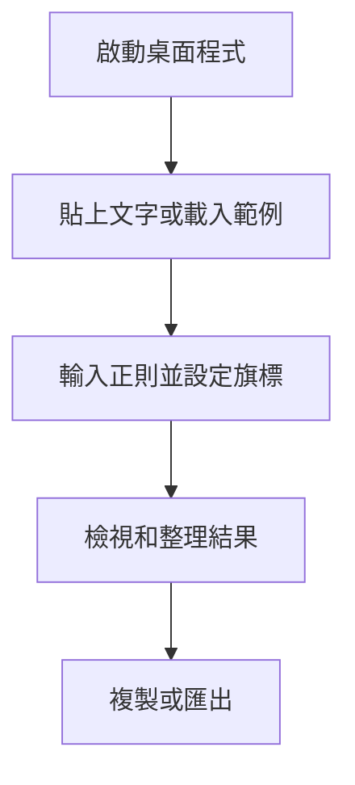

# Regex Extract & Tabular 使用者操作手冊

Regex Extract & Tabular 可將文字中的正則匹配擷取成表格，並匯出為 CSV、TSV、JSON、Markdown 或 SQL Insert。文字與正則在本機執行，不會傳送到伺服器。

## 目錄

- [快速開始](#快速開始)
- [整體使用流程](#整體使用流程)
- [擷取與整理結果](#擷取與整理結果)
- [複製、預覽與匯出](#複製預覽與匯出)
- [離線與資料安全](#離線與資料安全)
- [常見問題](#常見問題)
- [維護者驗證](#維護者驗證)

## 快速開始

1. 在 Windows 執行建置好的 `regex-extract-tabular.exe`。若尚未建置，請參閱「維護者驗證」。
2. 將待分析文字貼到「貼上要分析的文字」。也可從右上角載入 Nginx、訂單、聯絡人或 Git Commit 範例。
3. 在正則欄輸入 JavaScript 正則表達式；結果會即時更新。程式預設啟用全域 `g` 與多行 `m` 旗標，可視需要切換 `i`（忽略大小寫）、`s`（點號匹配換行）及 `u`（Unicode）。
4. 在擷取結果檢視欄位和匹配筆數，再依需要篩選、排序、複製或下載。

## 擷取與整理結果

- 使用 `(?<欄位名稱>...)` 建立有名稱的欄位；未命名捕獲群組會顯示為 Group 1、Group 2 等。若正則沒有捕獲群組，表格會以完整匹配作為欄位。
- 點擊正則欄旁的範本按鈕，可插入日期時間、電子郵件、URL、IP 位址或金額範本。
- 「修剪空白」會移除捕獲值頭尾空白；「排除空列」會略過所有捕獲值皆空的匹配；「空值顯示」可設定空值替代文字。
- 在結果上方輸入文字可搜尋欄位值或完整匹配。點欄名排序；用「管理欄位」隱藏欄位或重新命名匯出欄名。
- 可選擇每頁 10、25、50 或 100 筆。結果最多擷取 50,000 筆；單次解析超過 500 毫秒會中止，請簡化正則或縮小輸入。
- 「清除」會清空輸入、正則與結果篩選。

## 複製、預覽與匯出

在「匯出格式與進階選項」選擇 CSV、TSV、JSON、Markdown 或 SQL Insert。CSV/TSV 可調整分隔符；JSON 可選擇 Minified、保留內部欄位與完整匹配；SQL 可設定資料表名稱。欄位顯示狀態與名稱會套用到輸出。結果篩選也會套用到匯出內容。

選「複製」可將輸出放到剪貼簿；展開「預覽輸出內容」可先檢查文字。選「下載」後，桌面程式會開啟另存檔案對話框，預設檔名為 `regex-export-日期.副檔名`。

## 離線與資料安全

解析完全在本機完成，應用程式設定禁止網路連線。輸入內容不會自動保存；若要保留結果，請自行複製或匯出檔案。清除輸入或關閉程式前，先確認需要的結果已匯出。匯出檔案會寫入你在儲存對話框選擇的位置。

## 常見問題

- **結果顯示正則無效：** 檢查括號、跳脫字元與旗標；錯誤原因會顯示在正則設定區下方。
- **解析器未啟動：** 請透過桌面程式啟動。若在瀏覽器預覽前端，請從專案根目錄執行 `py -m http.server 8000`，再瀏覽 `http://localhost:8000/web/`；直接用 `file://` 開啟會阻止 Web Worker 啟動。
- **解析逾時或結果達上限：** 縮短輸入或簡化正則。程式會在 500 毫秒後停止解析，並將匹配數限制為 50,000 筆。
- **下載未開始：** 確認另存對話框已選擇位置；若瀏覽器阻擋剪貼簿操作，可展開預覽並手動複製。

## 維護者驗證

在專案根目錄執行 `npm install` 安裝 Tauri CLI。`npm run dev` 啟動桌面開發版，`npm run check` 檢查 Rust 程式，`npm test` 執行 Rust 測試，`npm run build` 建置未封裝的 Windows 執行檔至 `src-tauri/target/release/`。也可執行 `build.bat` 建置。前端操作可在桌面開發版中手動驗證。
